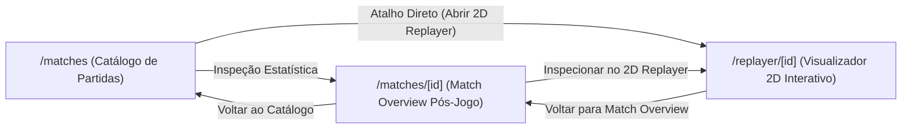

# Especificação Técnica 02 — Shell Global, Roteamento App Router e Sincronização de Filtros

## 1. Taxonomia de Rotas Canônicas (Next.js App Router)

O frontend analítico do **CS2 Analyzer** adota o App Router do Next.js sob um Shell Global escuro inspirado em plataformas táticas profissionais (Skybox / Edge), composto por menu lateral retrátil (`Sidebar`) e barra de controle analítico (`FilterBar`).

| Rota Canônica | Arquivo (`src/app/...`) | Papel Funcional |
| :--- | :--- | :--- |
| `/matches` | `src/app/matches/page.tsx` | **Catálogo de Partidas:** Lista as demos processadas, placares, mapa e oferece entrada para o resumo pós-jogo ou abertura direta do Replayer 2D. |
| `/matches/[id]` | `src/app/matches/[id]/page.tsx` | **Match Overview Pós-Jogo:** Painel consolidado de uma partida específica (KPIs globais de TTD, TTK, FSP, placar por metades e link contextual para inspeção tática no Replayer 2D). |
| `/replayer/[id]` | `src/app/replayer/[id]/page.tsx` | **Visualizador Tático 2D Interativo:** Viewport dedicado à reprodução tick a tick do pacote de telemetria armazenado em `data/replays/[id]/` (resolvido via `/api/replays/[id]`). Suporta recolhimento/ocultação do Shell Global (`Modo Tela Cheia`) para maximizar a área útil do radar $1024 \times 1024$. |
| `/stats/player` | `src/app/stats/player/page.tsx` | **Dashboard Analítico do Jogador:** Deep-dive individual segmentado nas 5 abas canônicas (`Intro`, `Roles`, `Weapons`, `Buy Types`, `Maps`), reagindo diretamente aos filtros globais da URL. |
| `/leaderboards` | `src/app/leaderboards/page.tsx` | **Tabelas de Classificação:** Ranking comparativo entre jogadores nas métricas mecânicas e táticas (Avg TTD, Avg TTK, First Shot Precision). |

---

## 2. Contrato de Sincronização Bidirecional via URL (`URLSearchParams`)

O estado global de filtragem (`GlobalFilterState`) tem a **URL como única fonte de verdade (Single Source of Truth)** para garantir compartilhamento de links (deep-linking), navegação via histórico do navegador e resiliência contra parâmetros corrompidos.

### Parâmetros e Fallbacks Defensivos (`DEFAULT_FILTER_STATE`)

| Chave de Estado / Query Param | Tipo | Valores Aceitos | Fallback Padrão (`DEFAULT_FILTER_STATE`) |
| :--- | :--- | :--- | :--- |
| `targetPlayerId` | `string \| null` | SteamID64 ou ID não-vazio (após `trim()`) | `null` |
| `selectedMap` | `CS2Map \| 'all'` | `'all'` ou um dos 7 mapas de `MAP_CONFIGS` | `'all'` |
| `tacticalSide` | `TacticalSide` | `'both' \| 'ct' \| 't'` | `'both'` |
| `timeWindow` | `TimeWindow` | `'last_5' \| 'last_10' \| 'last_20' \| 'all'` | `'last_10'` |

### Regras de Parsing e Serialização (`src/utils/filter-params.ts`)

1. **Deserialização Defensiva (`parseFilterParams`):**
   - Qualquer valor injetado manualmente na URL fora do domínio estrito (ex.: `?tacticalSide=sniper` ou `?selectedMap=de_aztec`) é silenciosamente neutralizado e revertido ao valor default correspondente (`'both'` e `'all'`, respectivamente).
   - Strings vazias ou compostas apenas por espaços em `targetPlayerId` convertem-se em `null`.

2. **Serialização Limpa (`serializeFilterParams`):**
   - Valores idênticos ao `DEFAULT_FILTER_STATE` são **omitidos** da query string gerada, mantendo a URL enxuta (ex.: alterar apenas `tacticalSide` para `'ct'` produz `?tacticalSide=ct` em vez de poluir a URL com todos os defaults).
   - A propriedade `parseFilterParams(serializeFilterParams(state))` preserva paridade bidirecional exata.

---

## 3. Fluxo de Transição Entre Catálogo, Match Overview e 2D Replayer

1. **A partir do Catálogo (`/matches`):** O analista pode optar por abrir o resumo executivo da partida (`/matches/[id]`) ou saltar diretamente para a reprodução tática no radar (`/replayer/[id]`).
2. **A partir do Match Overview (`/matches/[id]`):** Após identificar anomalias estatísticas ou rounds críticos, o usuário aciona a transição direta para `/replayer/[id]` mantendo o mesmo identificador `id`.
3. **No Visualizador 2D (`/replayer/[id]`):** O layout raiz (`AppShell`) disponibiliza o controle de **Modo Tela Cheia (Ocultar Shell)**, permitindo recolher `Sidebar` e `FilterBar` sob demanda sem perder o contexto da rota.

