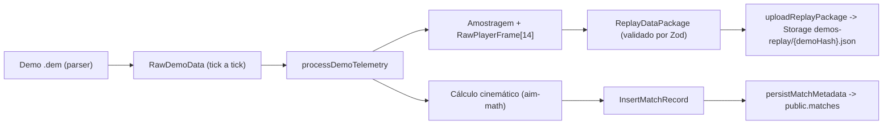

# Especificação Técnica 05 — Pipeline de Ingestão de Demos

## 1. Fluxo End-to-End

1. **Extração:** o parser entrega `RawDemoData` (jogadores identificados por `steamId`, ticks por round, eventos e duelos).
2. **Amostragem:** por round, mantém-se apenas ticks com `(tick - startTick) % samplingRate === 0` (padrão 4, tickrate 64).
3. **Compactação:** cada jogador vira `RawPlayerFrame` de 14 posições (ver `.spec/01-data-contracts`). `yaw` é normalizado para `[0, 360)`, `hp`/`armor` são limitados a `[0, 100]` e flags viram `0 | 1`. IDs numéricos compactos substituem `steamId`.
4. **Cálculo cinemático:** TTD, TTK e FSP globais agregados a partir dos duelos usando `src/utils/aim-math.ts`.
5. **Persistência:** o JSON minificado vai ao bucket `demos-replay` em `${demoHash}.json` (`upsert: true`, idempotente por hash); depois o registo é inserido em `public.matches` com `replay_storage_path = ${demoHash}.json`.

> O pacote não é comprimido com gzip: o JSON é apenas minificado, para ser consumido diretamente pelo navegador via URL pública.

## 2. Agregados Globais

| Coluna | Cálculo | Arredondamento |
| :--- | :--- | :--- |
| `global_avg_ttd_ms` | média de `(firstDamageTick - firstSightTick) * 1000 / tickrate` | inteiro (`Math.round`) |
| `global_avg_ttk_ms` | média de `(killTick - firstDamageTick) * 1000 / tickrate` (duelos com dano e abate) | inteiro |
| `global_avg_fsp_pct` | `duelos com primeiro tiro no alvo / duelos válidos * 100` | 2 casas decimais |

Sem amostras válidas, o valor é `null` (colunas anuláveis no Postgres).

## 3. Placar e Lados (MR12)

`score_ct` e `score_t` pertencem à **equipe que iniciou como CT** e à que iniciou como T. A partir do round 13 os lados invertem, então a vitória de `T` no round 13+ conta para a equipe que iniciou como CT.

## 4. Tolerância a Anomalias Temporais

| Anomalia | Política |
| :--- | :--- |
| Duelo com ticks não finitos, negativos ou fora de ordem (`sight <= damage <= kill`) | Duelo inteiro descartado (não entra em TTD, TTK nem FSP) |
| Tick de frame fora de `[startTick, endTick]` do round | Frame ignorado |
| Evento ou frame com `steamId` desconhecido | Ignorado |
| Valores numéricos não finitos nos frames | Fallback seguro (`0`) |
| Mapa fora dos 7 canônicos, `demoHash` vazio, 0 ou mais de 60 rounds | Erro explícito; nada é persistido |
| `calculateTimeToDamage` com ordem invertida | Devolve `0` (proteção adicional) |

## 5. Janela Máxima de Trade Kill

- Janela canônica de **4000 ms** (`DEFAULT_TRADE_WINDOW_MS`), calculada por `isTradeKill(victimDeathTick, revengeKillTick, tickrate, maxWindowMs = 4000)`.
- A vingança deve ocorrer **após** a morte do aliado (`delta >= 0`), com `delta_ms <= janela` (inclusive).
- A 64 tickrate, 256 ticks equivalem a exatamente 4000 ms.

## 6. Erros de Persistência

- Falha no upload lança erro e **impede** a inserção em `matches` (evita registo sem replay).
- O fluxo recomendado é `uploadReplayPackage` e, só depois, `persistMatchMetadata`.
- Se a inserção falhar após o upload, o objeto no Storage permanece. É seguro reexecutar, porque o upload usa `upsert` e `demo_hash` é único.

