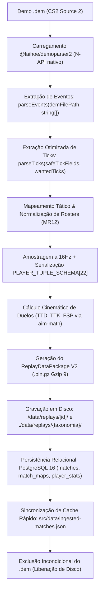

# Especificação Técnica 05 — Pipeline de Ingestão de Demos

## 1. Fluxo End-to-End e Persistência Local-First

O pipeline automatizado de ingestão (`scripts/process-demo.mjs`) processa arquivos de replay de Counter-Strike 2 (`.dem`), convertendo streams binários brutos do motor Source 2 em estruturas relacionais analíticas (PostgreSQL 16) e pacotes de telemetria ultracompactos (`.bin.gz` Gzip nível 9) consumidos pelo Replayer 2D.



1. **Extração Nativa Segura:** O módulo nativo `@laihoe/demoparser2` é invocado através de wrappers defensivos que garantem estrita conformidade de tipos com a camada N-API e eliminam propriedades com risco de vazamento de memória na Source 2.
2. **Amostragem Tática a 16Hz:** A partir do tickrate base (padrão 64 sub-tick), calcula-se uma janela de amostragem a cada 4 ticks (`samplingStep: 4`), reduzindo o volume de telemetria sem perda perceptual.
3. **Compactação Canônica V2:** Cada snapshot de atleta é serializado na tupla indexada de 22 posições (`PLAYER_TUPLE_SCHEMA`), preservando precisão sub-pixel (float com 1 casa decimal), velocidades vetoriais (`vx, vy, vz`) e flags de estado físico/tático.
4. **Cálculo Cinemático de Duelos:** Avaliação de TTD (*Time to Damage*), TTK (*Time to Kill*) e FSP (*First Shot Precision*) agregados a partir dos disparos e confrontos diretos via `src/utils/aim-math.ts`.
5. **Persistência Dupla em Disco:** O replay comprimido é gravado no diretório canônico do frontend (`./data/replays/[id]/`) e na taxonomia cronológica analítica (`./data/replays/{mes-ano}/{dd-mm-aaaa}/{times}_{formato}/`), acompanhado de espelhos de metadados em `match.json`.
6. **Persistência Relacional:** Inserção estruturada no PostgreSQL local nas tabelas `matches`, `match_maps` e `player_stats`.
7. **Exclusão Incondicional do `.dem`:** Como política de retenção estrita e economia de espaço em disco, o arquivo `.dem` de entrada é sumariamente removido após o término do processamento ou em bloco `finally`, mesmo em caso de erro na gravação.

---

## 2. Ingestão Nativa N-API (`@laihoe/demoparser2`)

A comunicação entre o ambiente Node.js/V8 e o motor de análise compilado em Rust/C++ (`@laihoe/demoparser2` / `demoparser2`) ocorre através da interface nativa **Node-API (N-API)**.

### 2.1 Exigência Arquitetural Estrita: Arrays de Strings em `parseEvents`

O binding nativo Rust (implementado via `napi-rs`) impõe verificação estrita de tipo para cada argumento recebido do runtime JavaScript.

- **Assinatura Nativa:**
  ```ts
  parseEvents(filepath: string, eventNames: string[], extraProps?: string[]): Record<string, any>[]
  ```
- **O Erro Fatal `Given napi value is not an array`:**
  Caso o desenvolvedor ou caller passe um valor escalar (string primitiva) como segundo argumento — por exemplo, `demoparser.parseEvents(path, 'round_end')` —, a camada de conversão da N-API falha imediatamente na validação de tipo de argumentos, disparando uma exceção de pânico nativo não tratada:
  ```
  Error: Given napi value is not an array
  ```
  Essa falha aborta a execução do parser ou rejeita a Promise de forma destrutiva.

### 2.2 Padrão de Encapsulamento Defensivo (`parseEv`)

Para assegurar estabilidade contínua na ingestão, `scripts/process-demo.mjs` implementa a rotina de normalização `parseEv`, que atende a três requisitos fundamentais:

```js
const parseEv = (eventInput, extraProps) => {
  // 1. Garante que eventNames seja impreterivelmente um Array de Strings
  const eventNames = Array.isArray(eventInput) ? eventInput : [eventInput];
  const singleName = typeof eventInput === 'string' ? eventInput : eventNames[0];
  const safeProps = Array.isArray(extraProps) && extraProps.length > 0 ? extraProps : undefined;

  // 2. Consulta prévia no cache consolidado da demo (otimização de FFI)
  if (eventsByName.has(singleName)) {
    const cached = eventsByName.get(singleName);
    if (cached && cached.length > 0) return cached;
  }

  // 3. Chamada nativa ao parseEvents com validação de tipo garantida
  if (typeof demoparser.parseEvents === 'function') {
    try {
      if (safeProps) {
        const res = demoparser.parseEvents(demFilePath, eventNames, safeProps);
        if (Array.isArray(res) && res.length > 0) return res;
      }
    } catch {}
    try {
      const res = demoparser.parseEvents(demFilePath, eventNames);
      if (Array.isArray(res) && res.length > 0) return res;
    } catch {}
  }

  // 4. Fallback secundário para parseEvent (singular), que aceita string escalar
  if (typeof demoparser.parseEvent === 'function') {
    try {
      if (safeProps) {
        const res = demoparser.parseEvent(demFilePath, singleName, safeProps);
        if (Array.isArray(res)) return res;
      }
    } catch {}
    try {
      const res = demoparser.parseEvent(demFilePath, singleName);
      if (Array.isArray(res)) return res;
    } catch {}
  }

  return [];
};
```

> **Estratégia de Cache em Lote (`CONSOLIDATED_EVENTS`):** O pipeline dispara uma única chamada agregada a `parseEvents` no início da extração contendo todos os eventos de interesse do Counter-Strike 2 (`round_start`, `round_end`, `player_death`, `weapon_fire`, `player_hurt`, `bomb_planted`, granadas, etc.). Isso minimiza alternâncias de contexto (FFI context switches) entre V8 e o código binário compilado.

---

## 3. Otimização do `parseTicks` e Prevenção de Estouro de Memória no Engine da Source 2

A extração de telemetria posicional tick a tick via `demoparser.parseTicks(demFilePath, fields, wantedTicks)` demanda controle minucioso dos campos solicitados às tabelas de rede da Valve.

### 3.1 Regra de Exclusão da Propriedade Legada `'cash'`

Na definição da lista `tickFields` passada ao parser, **é terminantemente proibida a inclusão da propriedade `'cash'` ou de qualquer campo cujo identificador inicie com `'cash'`**:

```js
const safeTickFields = tickFields.filter((f) => f !== 'cash' && !f.startsWith('cash'));
```

### 3.2 Causa Técnica de Degradação no Motor Source 2

1. **Herança Legada do CS:GO:** No Counter-Strike 2, `'cash'` é uma entidade residual/legada da engine anterior. A tentativa de resolução dessa propriedade força o parser a percorrer recursivamente todas as árvores de entidades globais e tabelas de rede em cada tick individual amostrado.
2. **Pico Extremo de Alocações e Heap Exhaustion:** Em partidas competitivas completas (20 a 30 rounds, totalizando de $40.000$ a $80.000$ ticks amostrados), a varredura contínua de `'cash'` gera dezenas de gigabytes de estruturas temporárias alocadas na heap C++/Rust. Esse comportamento culmina em vazamento de memória progressivo, lentidão de minutos por partida e encerramento abrupto do processo por estouro de memória (*Out-Of-Memory* / fatal OOM abort).

### 3.3 Substituição Canônica por `'account'` e `'balance'`

Para capturar a economia do jogador sem overhead do motor:
- O pipeline solicita exclusivamente as propriedades **`'account'`** e **`'balance'`**, que refletem diretamente o campo canônico de rede da Source 2:
  `m_pInGameMoneyServices.m_iAccount`
- A leitura ocorre em tempo constante $O(1)$ por entidade e tick, reduzindo o consumo de memória em mais de $90\%$ e acelerando a extração em até $10\times$.

### 3.4 Pré-cálculo de Janelas Úteis (`preRoundWindows`) e Fallback Mínimo

Para evitar que o parser examine ticks mortos (fase pós-partida ou pausas técnicas desnecessárias), o pipeline calcula janelas úteis `[startTick, endTick]` com passo de 4 ticks (`samplingStep: 4`), gerando um array ordenado e deduplicado `wantedTicks`.

Caso a extração expandida encontre incompatibilidade com a versão interna do binário, é acionado um fallback com campos mínimos seguros:

```js
tickRows = demoparser.parseTicks(demFilePath, [
  'steamid', 'name', 'team_num', 'team_clan_name',
  'X', 'Y', 'Z', 'yaw', 'pitch',
  'health', 'armor_value', 'has_helmet', 'is_alive', 'account'
], wantedTicks) || [];
```

---

## 4. Contrato Canônico da Tupla V2 (22 Posições) e Tratamento Sub-pixel

O estado de cada atleta em cada snapshot de round é registrado no contrato canônico de tupla indexada de 22 posições:

### 4.1 Estrutura Canônica (`PLAYER_TUPLE_SCHEMA`)

| Índice | Campo | Tipo | Descrição e Normalização |
| :---: | :--- | :--- | :--- |
| `[0]` | `id` | `number \| string` | Identificador indexado (1 a 10) vinculado ao manifesto de jogadores |
| `[1]` | `x` | `number` (float, 1 dec.) | Coordenada X mundial Source 2 (`roundTo(X, 1)`) |
| `[2]` | `y` | `number` (float, 1 dec.) | Coordenada Y mundial Source 2 (`roundTo(Y, 1)`) |
| `[3]` | `z` | `number` (float, 1 dec.) | Coordenada Z mundial / altitude (`roundTo(Z, 1)`) |
| `[4]` | `yaw` | `number` (float, 1 dec.) | Ângulo horizontal de mira normalizado em $[0, 360]$ (`roundTo(((rawYaw % 360) + 360) % 360, 1)`) |
| `[5]` | `pitch` | `number` (float) | Ângulo vertical de visão limitado em $[-89, 89]$ |
| `[6]` | `vx` | `number` (float) | Velocidade vetorial no eixo X |
| `[7]` | `vy` | `number` (float) | Velocidade vetorial no eixo Y |
| `[8]` | `vz` | `number` (float) | Velocidade vetorial no eixo Z |
| `[9]` | `hp` | `number` (inteiro) | Pontos de vida no intervalo $[0, 100]$ |
| `[10]` | `armor` | `number` (inteiro) | Colete de proteção no intervalo $[0, 100]$ |
| `[11]` | `hasHelmet` | `0 \| 1` | Indicador binário de capacete |
| `[12]` | `isAlive` | `0 \| 1` | Indicador binário de sobrevivência (`is_alive && hp > 0`) |
| `[13]` | `activeWeapon` | `string \| number` | Nome da arma ativa (`'weapon_ak47'`) ou ID catalogado |
| `[14]` | `money` | `number` (inteiro) | Economia atual do atleta extraída de `'account'` |
| `[15]` | `team` | `number \| string` | Lado tático (`3` ou `'CT'`; `2` ou `'T'`) |
| `[16]` | `isDefusing` | `0 \| 1` | Indicador binário de ação ativa de desarmamento da C4 |
| `[17]` | `hasDefuser` | `0 \| 1` | Indicador binário de posse do kit de desarme |
| `[18]` | `isScoped` | `0 \| 1` | Indicador binário de uso de mira telescópica (scope) |
| `[19]` | `isCrouching` | `0 \| 1` | Indicador binário de postura agachada |
| `[20]` | `isAirborne` | `0 \| 1` | Indicador binário de salto ou queda livre |
| `[21]` | `flashDuration` | `number` (float, 2 dec.) | Tempo restante de cegueira em segundos (`roundTo(flash_duration, 2)`) |

### 4.2 Supressão de Jitter por Resolução Sub-pixel

- **Problema de Truncagem Inteira:** Converter posições globais com `Math.round(x)` gera artefatos visuais de "degraus" (stepping) durante a interpolação linear contínua a 60 FPS no Canvas 2D. Esse jitter é particularmente perceptível quando os jogadores caminham em marcha lenta (shift walk) ou em trajetórias diagonais.
- **A Solução Canônica (1 Casa Decimal):** Ao fixar 1 casa decimal (`roundTo(val, 1)`), preserva-se a precisão sub-pixel de $0.1$ unidade da Source 2 (menos de $0.02\text{ px}$ no radar $1024 \times 1024$), suprimindo completamente o jitter visual perceptível sem o peso de armazenamento de floats de 64 bits não arredondados.
- **Transição Suave de Cegueira:** A preservação de `flashDuration` com 2 casas decimais garante decaimento contínuo linear para esmaecimento visual do ícone de cego e anel perimétrico no viewport.

---

## 5. Persistência de Artefatos e Resolução de Replays

A ingestão gera e armazena os artefatos de partida em duas hierarquias de diretórios sob `./data/replays/`:

```
data/
└── replays/
    ├── [matchId]/                                  <-- Diretório Canônico de Acesso Direto
    │   ├── [matchId].bin.gz                        <-- Telemetria principal comprimida (Gzip 9)
    │   ├── replay.bin.gz                           <-- Alias para streaming genérico
    │   ├── {nome_original_da_demo}.bin.gz          <-- Cópia de preservação
    │   ├── match.json                              <-- Metadados completos da partida em JSON
    │   └── {nome_original_da_demo}.json            <-- Espelho de metadados
    │
    └── {mes-ano}/                                  <-- Taxonomia Cronológica Analítica
        └── {dd-mm-aaaa}/
            └── {Time1}_vs_{Time2}_{Formato}/
                └── {nome_original_da_demo}.bin.gz
```

### 5.1 Consumo e Resolução pela API Local

O frontend e o motor do Replayer 2D utilizam rotas Next.js App Router dedicadas com múltiplos níveis de fallback:

1. **Metadados da Partida (`GET /api/matches/[id]`):**
   - **Etapa 1:** Executa `getMatchById(id)` no PostgreSQL local.
   - **Etapa 2 (Fallback em Disco):** Se o banco estiver desligado ou não contiver a partida, lê `data/replays/[id]/match.json`.
   - **Etapa 3 (Fallback Estático):** Inspeciona `src/data/ingested-matches.json`.
   - **Retorno:** JSON com metadados estruturados `{ match }`.

2. **Stream de Telemetria (`GET /api/replays/[id]`):**
   - **Etapa 1:** Consulta o `replay_path` no PostgreSQL.
   - **Etapa 2 (Fallback em Disco):** Inspeciona `data/replays/[id]/` por arquivos `.bin.gz` ou `.json`.
   - **Etapa 3 (Fallback Canônico):** Carrega a partida canônica default (`54e43847-2490-4751-9981-831bf7cf367c`).
   - **Transmissão:** Entrega um `ReadableStream<Uint8Array>` em binário comprimido com `Content-Type: application/octet-stream`. Caso o parâmetro `?format=json` seja enviado, descompacta no servidor e devolve JSON com cabeçalho `Cache-Control: public, max-age=3600`.

3. **Renderização no Replayer 2D (`ReplayEngine` + `src/lib/replay/decompress.ts`):**
   - Dispara requisições paralelas para `/api/matches/[id]` e `/api/replays/[id]`.
   - Descomprime o stream gzip no cliente via `DecompressionStream('gzip')` (com fallback em blocos de 64KB via `pako`), cedendo a thread a cada 256KB (`setTimeout(r, 0)`) para prevenir travamentos de tela.
   - Normaliza os snapshots via `normalizeReplayPayload` e interpola as posições a 60 FPS no Canvas 2D.

---

## 6. Agregados Globais (TTD, TTK, FSP)

| Coluna | Cálculo | Arredondamento |
| :--- | :--- | :--- |
| `global_avg_ttd_ms` | média de `(firstDamageTick - firstSightTick) * 1000 / tickrate` | inteiro (`Math.round`) |
| `global_avg_ttk_ms` | média de `(killTick - firstDamageTick) * 1000 / tickrate` (duelos com dano e abate) | inteiro (`Math.round`) |
| `global_avg_fsp_pct` | `duelos com primeiro tiro no alvo / duelos válidos * 100` | 2 casas decimais (`roundTo(..., 2)`) |

Sem amostras válidas de duelos na partida, o valor é gravado como `null` (colunas anuláveis no PostgreSQL).

---

## 7. Placar e Lados (Formato MR12)

- No formato oficial MR12, as variáveis `score_ct` e `score_t` pertencem estritamente à **equipe que iniciou a partida como CT** e à que iniciou como T.
- A partir do round 13 (início da segunda metade), os lados invertem-se no jogo; assim, a vitória de `T` no round 13+ soma pontos para a equipe que começou a partida como CT.

---

## 8. Tolerância a Anomalias Temporais

| Anomalia | Política de Tratamento |
| :--- | :--- |
| Duelo com ticks não finitos, negativos ou fora de ordem (`sight <= damage <= kill`) | Duelo inteiro descartado (não entra em TTD, TTK nem FSP) |
| Tick de frame fora de `[startTick, endTick]` do round | Frame ignorado |
| Evento ou frame com `steamId` desconhecido | Ignorado defensivamente |
| Valores numéricos não finitos nos frames (`NaN`, `Infinity`) | Substituído por fallback seguro (`0`) |
| Mapa fora dos 7 canônicos competitivos, `demoHash` vazio, 0 ou mais de 60 rounds | Erro explícito; gravação abortada |
| `calculateTimeToDamage` com ordem invertida | Devolve `0` como proteção adicional |

---

## 9. Janela Máxima de Trade Kill

- Janela canônica de **4000 ms** (`DEFAULT_TRADE_WINDOW_MS`), calculada por `isTradeKill(victimDeathTick, revengeKillTick, tickrate, maxWindowMs = 4000)`.
- A vingança deve ocorrer **após** a morte do aliado (`delta >= 0`), com `delta_ms <= janela` (inclusive).
- Em 64 tickrate, 256 ticks equivalem a exatamente 4000 ms.

---

## 10. Resiliência e Políticas de Transação Local

1. **Garantia de Replay Antes de Metadados:** O arquivo de replay comprimido `.bin.gz` e os artefatos em `data/replays/[id]/` são sempre gravados **antes** da inserção de registros nas tabelas `matches`, `match_maps` e `player_stats`. Se a gravação em disco falhar, a inserção no PostgreSQL é abortada para evitar referências fantasmas.
2. **Idempotência por `demo_hash`:** A tabela `matches` possui restrição de unicidade em `demo_hash`. Reexecuções do pipeline atualizam os registros via transação segura sem duplicidade de dados.
3. **Resiliência a Falhas do Banco:** Caso o PostgreSQL esteja temporariamente inacessível, os artefatos gravados em `data/replays/[id]/match.json` e a sincronização em `src/data/ingested-matches.json` garantem que a UI e o Replayer 2D continuem operando normalmente via fallback local.
